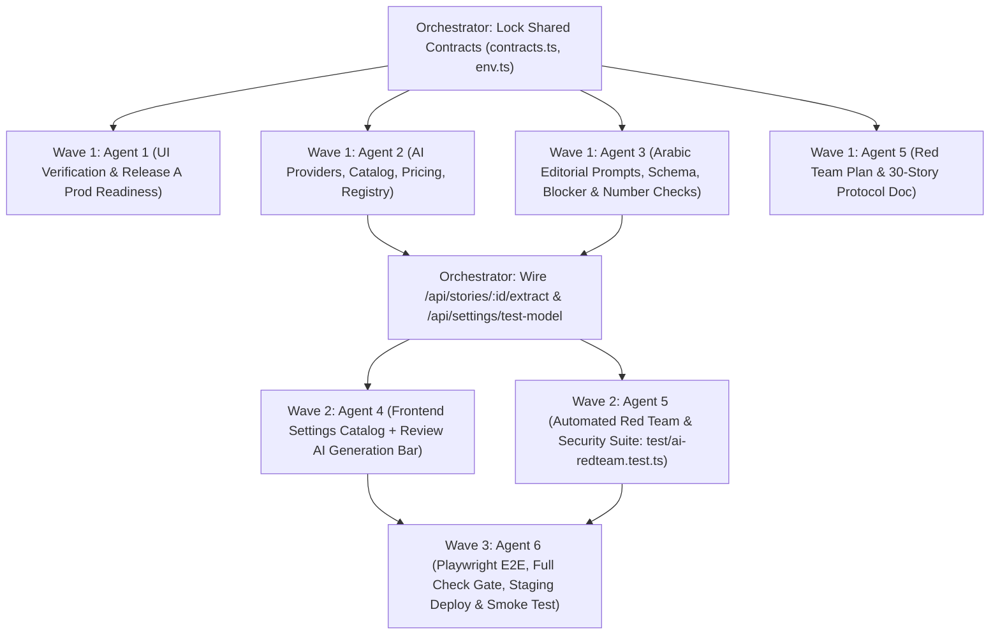

# NAS Newsroom — Multi-Agent Orchestration & Execution Plan

**Repository**: `https://github.com/sufyanaser/NAS-NEWS-AGENT`  
**Development Branch**: `develop`  
**Production Branch**: `main`  
**Staging Environment**: `https://nas-newsroom-staging.nasfm98-7.workers.dev`  
**Approved Production Target**: `https://nr.nasfm.info`

---

## 1. جدول الوكلاء ومسؤولياتهم (Subagents Roster)

| الوكيل (Subagent ID) | الدور التخصصي (Role) | نطاق المسؤولية الأساسي |
|---|---|---|
| **Orchestrator** | Principal Engineering Orchestrator | قفل العقود المشتركة (`src/shared/contracts.ts`, `src/server/env.ts`)، تنسيق التوازي والاعتماديات، ربط المسارات في `src/worker.ts` و`src/server/stories.ts` و`src/server/settings.ts`، ومراجعة الدمج النهائي. |
| **Agent 1** (`agent-1-ui-prod-readiness`) | UI/UX Finalizer & Production Release Engineer | التحقق من اكتمال المهام الـ15 لواجهة غرفة الأخبار على Staging، فحص جاهزية النطاق الرسمي `nr.nasfm.info` (DNS / Zone / SSL / Cookies / Allowed Origin / Prod D1 plan) وتجهيز مرشح الإطلاق الأول **Release A** مع بوابة طلب الإذن النهائي قبل لمس `nr.nasfm.info`. |
| **Agent 2** (`agent-2-ai-providers`) | AI Provider & Model Architecture Engineer | تصميم وبناء طبقة المزودين المتعددين (`Google Gemini`, `OpenAI`, `Anthropic Claude`, `OpenRouter`)، سجل النماذج الموثق بالأسعار الحقيقية (`ModelCatalog`)، حساب التكلفة التقريبية، إدارة المهلة وإعادة المحاولة (`Timeout & Retry`)، تصنيف الأخطاء، واختبار الاتصال الفعلي (`testConnection`). |
| **Agent 3** (`agent-3-editorial-pipeline`) | Arabic Editorial AI Pipeline Engineer | بناء خط أنابيب الاستخراج والصياغة الإذاعية العربية (`prompts.ts`, `schema.ts`, `pipeline.ts`)، عزل نص المصدر ضد `Prompt Injection`، التحقق الصارم من المخرجات المهيكلة، فرض حارس الأرقام (`Number Superset Check` — Specs §8.1)، وحساب `hasBlocker` خادمياً (Specs §7.3). |
| **Agent 4** (`agent-4-ai-frontend`) | Frontend AI & Settings Integration Engineer | ربط صفحة الإعدادات بكتالوج المزودين والنماذج وزر «اختبار الاتصال بالمزود»، وإضافة شريط التوليد الذكي في شاشة «المراجعة والتحرير» (توليد / إعادة توليد، حماية التعديلات اليدوية، عرض الكمون والتوكنات والتكلفة وتحذيرات الأرقام، والعمل اليدوي الكامل عند غياب المفتاح). |
| **Agent 5** (`agent-5-security-redteam-qa`) | Security, Red Team & Editorial QA Lead | بناء اختبارات الاختراق والحماية (`SC-01`, `SC-02`, `SC-03`, `Prompt Injection`, `Secret Canary`, `Rate Limit`, `CSRF`) وتوثيق بروتوكول التقييم التحريري المكون من 30 خبراً حقيقياً قبل ترقية الذكاء الاصطناعي للإنتاج. |
| **Agent 6** (`agent-6-integration-release`) | Integration, Verification & Staging/Prod Release Manager | تحديث اختبارات Playwright E2E لتشمل تدفقات الذكاء الاصطناعي والإعدادات، تشغيل بوابة الفحص الكاملة (`npm run check`)، النشر على `Staging`، والتحقق الحي النهائي. |

---

## 2. مصفوفة ملكية الملفات الصارمة (Strict File Ownership Matrix)

لمنع أي تعارض تحرير متزامن، يمتلك كل وكيل مجموعة ملفات معزولة تماماً:

| الوكيل | الملفات المملوكة حصرياً (Owned Files) |
|---|---|
| **Orchestrator** | `docs/04-implementation/AI_Multi_Agent_Execution_Plan.md` `src/shared/contracts.ts` `src/server/env.ts` `src/worker.ts` `src/server/settings.ts` `src/server/stories.ts` |
| **Agent 1** | `docs/04-implementation/Release_A_Production_Readiness.md` |
| **Agent 2** | `src/server/ai/types.ts` `src/server/ai/catalog.ts` `src/server/ai/registry.ts` `src/server/ai/providers/gemini.ts` `src/server/ai/providers/openai.ts` `src/server/ai/providers/anthropic.ts` `src/server/ai/providers/openrouter.ts` `test/ai-providers.test.ts` |
| **Agent 3** | `src/server/ai/prompts.ts` `src/server/ai/schema.ts` `src/server/ai/pipeline.ts` `test/ai-pipeline.test.ts` |
| **Agent 4** | `src/client/api.ts` `src/client/settings.ts` `src/client/review.ts` `src/client/styles.css` |
| **Agent 5** | `docs/04-implementation/QA_RedTeam_and_30Story_Protocol.md` `test/ai-redteam.test.ts` |
| **Agent 6** | `e2e/slice.spec.ts` `docs/04-implementation/Final_Multi_Agent_Delivery_Report.md` |

---

## 3. الاعتماديات وترتيب التنفيذ (Dependencies & Execution Waves)

1. **الخطوة التأسيسية (Orchestrator)**: قفل `src/shared/contracts.ts` و`src/server/env.ts` لضمان تطابق الأنواع بين جميع الوكلاء دون الحاجة لتعديل الملف نفسه من أكثر من وكيل.
2. **الموجة الأولى — بالتوازي (Wave 1 Parallel)**:
   - **Agent 1**: فحص شامل للمهام البصرية الـ15 على Staging وفحص جاهزية النطاق الرسمي `nr.nasfm.info` (Release A Candidate).
   - **Agent 2**: بناء طبقة المزودين الأربعة (`Gemini`, `OpenAI`, `Anthropic`, `OpenRouter`) وكتالوج النماذج الموثق واختبارات الوحدة الخاصة بها (`test/ai-providers.test.ts`).
   - **Agent 3**: بناء خط الأنابيب التحريري العربي (`prompts.ts`, `schema.ts`, `pipeline.ts`) واختبارات الوحدة الخاصة به (`test/ai-pipeline.test.ts`).
   - **Agent 5**: إعداد وثيقة الفحص الأمني وبروتوكول تقييم الـ30 خبراً (`docs/04-implementation/QA_RedTeam_and_30Story_Protocol.md`).
3. **نقطة الربط الخادمية (Orchestrator Server Wiring)**:
   - ربط `POST /api/stories/:id/extract` و`POST /api/settings/test-model` وتوسيع `GET /api/settings` و`PUT /api/settings` في `src/worker.ts` و`src/server/settings.ts` و`src/server/stories.ts`.
4. **الموجة الثانية — بالتوازي (Wave 2 Parallel)**:
   - **Agent 4**: تحديث واجهة الإعدادات وشاشة المراجعة والتحرير (`src/client/api.ts`, `src/client/settings.ts`, `src/client/review.ts`, `src/client/styles.css`).
   - **Agent 5**: تنفيذ اختبارات الاختراق والحماية الشاملة على نقاط النهاية الحقيقية (`test/ai-redteam.test.ts`).
5. **الموجة الثالثة — التكامل والنشر التجريبي (Wave 3 Sequential)**:
   - **Agent 6**: تحديث اختبارات Playwright E2E (`e2e/slice.spec.ts`)، تشغيل `npm run check` بالكامل، النشر على `Staging` (`nas-newsroom-staging`)، والتحقق الحي.

---

## 4. بوابات الجودة الصارمة (Quality Gates)

لا يُدمج عمل أي وكيل أو تُعلن جاهزية أي إصدار إلا بعد اجتياز:
1. **`npm run lint`**: صفر أخطاء ESLint.
2. **`npm run typecheck`**: صفر أخطاء TypeScript (`tsc --noEmit`).
3. **`npm run build` & `npm run check:bundle`**: بناء حزمة العميل والتأكد عبر `scripts/check-bundle.mjs` من خلو `dist/client` تماماً من أي إشارات لمفاتيح سرية أو متغيرات بيئة حساسة.
4. **`npm test` (Vitest)**: نجاح جميع اختبارات الوحدة والتكامل والـRed Team بنسبة 100% مع الحفاظ على ثوابت مخطط قاعدة البيانات (`test/schema-and-secrets.test.ts`).
5. **`npm run test:e2e` (Playwright)**: نجاح جميع اختبارات النهاية إلى النهاية على المتصفح عبر الخادم الفعلي.

---

## 5. بوابات النشر والإطلاق (Release Gates)

### البوابة 1 — Release A (Manual Newsroom Production Candidate → `https://nr.nasfm.info`)
- **المتطلبات المكتملة**: استقرار الشاشات الخمس، التصميم المتجاوب الخالي من التمرير الخارجي، الحفظ التلقائي، الاستيراد، التحرير اليدوي، الموانع التحريرية، الاعتماد البشري، والأرشيف.
- **حاجز الحوكمة (CLAUDE.md Rules 5 & 8)**: تجهيز ملف إعداد الإنتاج وفحص النطاق `nr.nasfm.info` بالكامل، ثم **التوقف لطلب الموافقة النهائية الصريحة من المستخدم** قبل تنفيذ أول ربط DNS / Custom Domain على `nr.nasfm.info` أو الدمج في الفرع `main`.

### البوابة 2 — Release B (Multi-Provider AI Newsroom → Staging & Production Upgrade Path)
- **على Staging (`https://nas-newsroom-staging.nasfm98-7.workers.dev`)**: يُنشر بالكامل ويُختبر حياً في هذه المهمة (كتالوج النماذج، اختبار الاتصال، توليد المسودات والحقائق، حماية التعديلات اليدوية، كشف الموانع التحريرية والأرقام الدخيلة، واستمرار العمل اليدوي عند غياب المفتاح).
- **قبل الترقية إلى Production (`https://nr.nasfm.info`)**:
  1. اجتياز سيناريوهات الاختبار `SC-01` و`SC-02` و`SC-03` واختبارات `Prompt Injection`.
  2. إتمام بروتوكول التقييم التحريري البشري على **30 مادة مصدرية حقيقية** (20 عربية + 10 إنجليزية) بمعدل:
     - صفر هلوسة في الأسماء والأرقام والتواريخ (`0% Hallucinated Facts`).
     - صفر ادعاء غير مسند يمر دون مانع تحريري (`0% Unflagged Unattributed Claims`).
     - ملاءمة الموجز الإذاعي (`20–40 ثانية`) في `>= 85%` من الأخبار دون إعادة كتابة كاملة.
  3. موافقة صريحة من المستخدم لترقية `nr.nasfm.info` إلى Release B.
